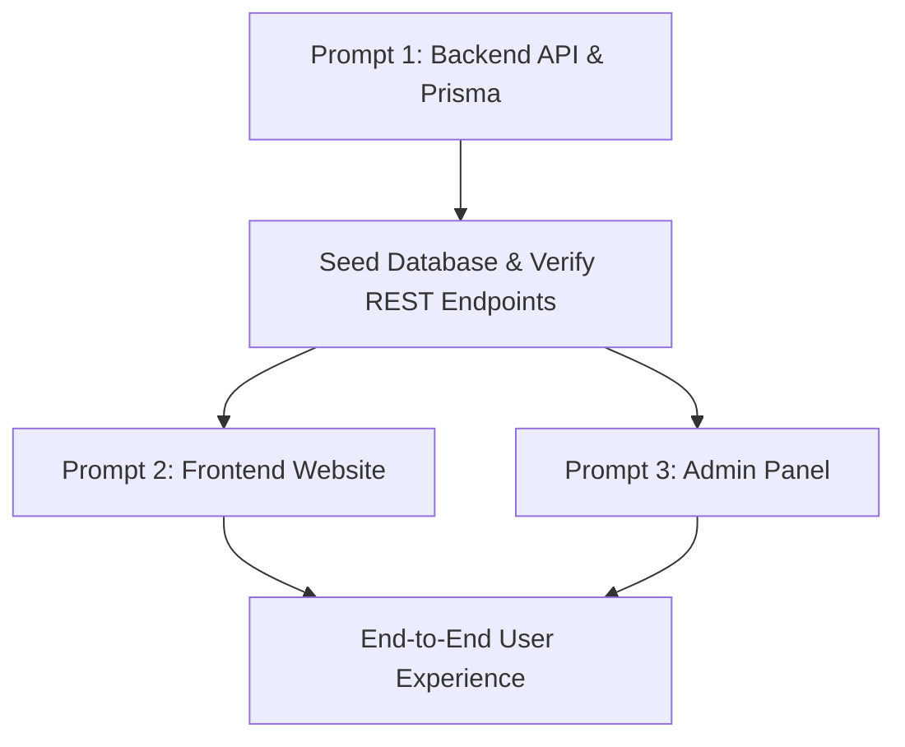

# Monorepo Master Development Prompts
## Bengali Story & Novel Publishing Platform

This directory contains three separate, copy-pasteable, step-by-step master development prompts designed for AI coding agents or engineers to build each respective application independently.

---

### Strict Global Design & Styling Constraints (Applies to all prompts):
1. **Pure Tailwind CSS Only**:
   - Absolutely **NO custom `.css` files**, NO CSS modules, and NO inline `style={{ ... }}` objects.
   - 100% of the UI, animations, cards, grids, and responsiveness must be written using Tailwind utility classes.
2. **Typography Pairing**:
   - English: **`Outfit`**
   - Bengali: **`Hind Siliguri`**
   - Browser fallback automatically renders English in Outfit and Bengali in Hind Siliguri.
3. **Theme Modes & Base Colors**:
   - Default Mode: **Light Mode (White `#ffffff`)** with `#242424` text.
   - Dark Mode: **Base `#242424`** with white text, `#2b2b2b` cards, `#3d3d3d` borders.
4. **Bilingual Localization (i18n)**:
   - Supported Locales: **Bangla (`bn` - Default)** and **English (`en`)**.
   - Persistent across all pages and sessions via `localStorage` and cookies (`bengali_story_locale`).
5. **Icon Library (`lucide-react` Only — ZERO Text Icons / Emojis)**:
   - Absolutely **NO emojis or text characters as UI icons**.
   - Every single icon must be an SVG component imported from `lucide-react` and styled with Tailwind utility classes.
6. **Media Database (Cloudinary Only)**:
   - All images (covers, avatars, banners) must be uploaded and hosted on **Cloudinary** using signed backend upload authorization.

---

### Master Prompts List:

1. [**PROMPT 1: Backend API Development (`docs/PROMPT_1_BACKEND.md`)**](file:///d:/Bengali%20Story/docs/PROMPT_1_BACKEND.md)
   - Database schema & Prisma setup (`packages/database`).
   - Express REST API architecture, Helmet, CORS, Rate-Limiting.
   - JWT Auth & HTTP-only cookie sessions.
   - Stories, chapters, submissions, approvals, reading progress, comments, likes.
   - Cloudinary signed upload integration.

2. [**PROMPT 2: Frontend Website Development (`docs/PROMPT_2_FRONTEND.md`)**](file:///d:/Bengali%20Story/docs/PROMPT_2_FRONTEND.md)
   - Next.js 14 App Router (Port 3000).
   - **100% Pure Tailwind CSS Only** (No custom CSS).
   - Outfit & Hind Siliguri font family.
   - White & #242424 light/dark modes.
   - Persistent bilingual localization (`বাং / EN`).
   - Homepage with Trending, Popular Novels, Categories, Featured Authors.
   - Story detail & long-form Chapter Reader (with font-size adjuster, reading themes, auto scroll progress).
   - Reader Dashboard (Library, History, Following, Notifications).
   - Writer Studio with Tiptap rich-text editor and Cloudinary cover uploader.

3. [**PROMPT 3: Admin Panel Development (`docs/PROMPT_3_ADMIN.md`)**](file:///d:/Bengali%20Story/docs/PROMPT_3_ADMIN.md)
   - Next.js 14 App Router (Port 3001).
   - **100% Pure Tailwind CSS Only** (No custom CSS).
   - Admin authentication & RBAC protection (ADMIN / MODERATOR).
   - Submissions Queue: Review pending stories & chapters, reader preview, 1-click Approve or Reject with feedback.
   - User Management: Search users, change roles, ban/unban.
   - Content Moderation & Reports Hub: Review flagged content, delete abusive comments.
   - Category Manager & Platform Settings (manual vs auto-approval, announcements).

---

### Recommended Execution Order

